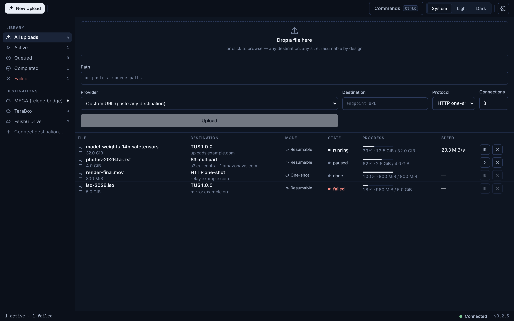
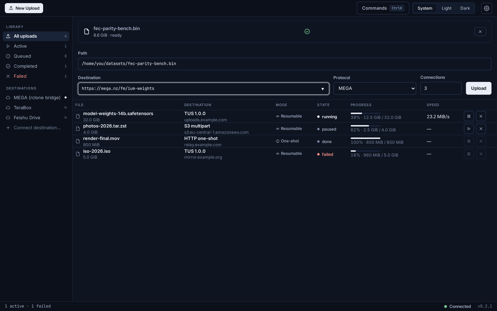
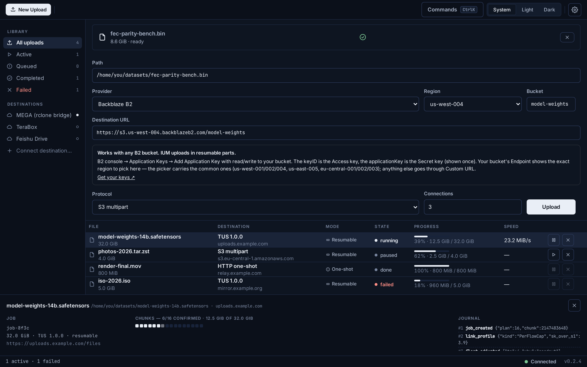
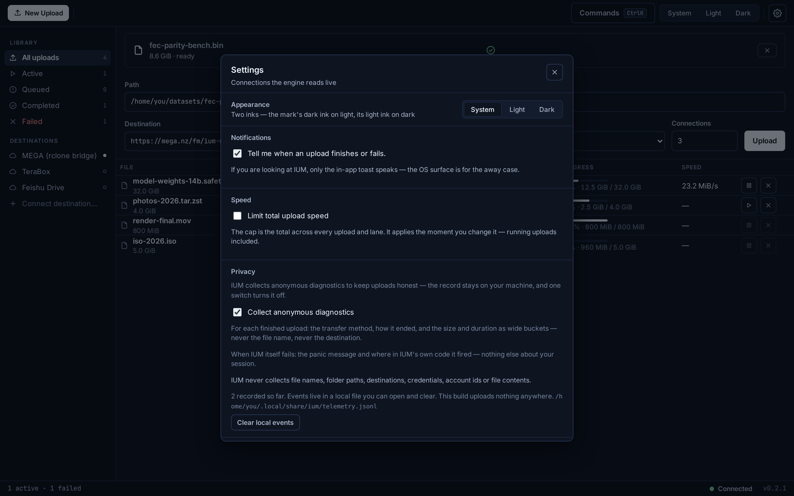
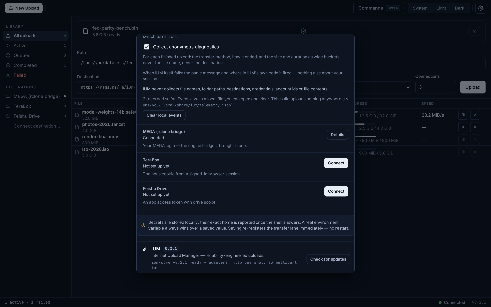
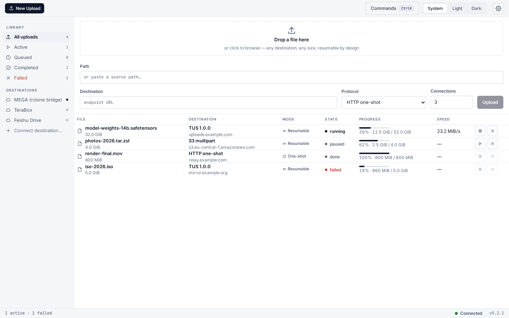

<div align="center">

  <picture>
    <source media="(prefers-color-scheme: dark)" srcset="assets/logo-white.svg" />
    
  </picture>

  # IUM

  **Reliability-engineered uploads for your desktop.**

  One window, any destination — S3-compatible storage, WebDAV, Google Drive,
  YouTube, Terabox, Feishu, Mega, plain HTTP, TUS — with resume that actually
  resumes, and progress that never lies to you.

  [Download](#download) · [Verify](#verify-your-download) · [Install](#install) · [User Guide](USERGUIDE.md) · [What's new](CHANGELOG.md)

  %20%7C%20Windows-lightgrey)
  
  

</div>

---

Every download manager solves *"a 5 GB file on a flaky 2 Mbps line"* — for **downloads**.
Uploads still get one fragile `POST` that dies at 90% and starts over. IUM applies twenty
years of download-manager engineering — chunk pools, adaptive split, slow-link eviction,
endgame racing, crash-safe journals — to the upload direction, and pairs it with a policy
the industry usually leaves implicit: **never claim what was not verified**.

IUM is a desktop app for Linux, macOS (Apple Silicon) and Windows. The upload engine is
built into the app — there is no service to install, no config file to write.

## Screenshots

The shipped shell in the **Ink** design language — dark first, because that is the default
scheme. A command toolbar, a library/destinations sidebar, the dense work list, and a status
bar — with a docked inspector and a centered settings modal.

| | |
|---|---|
|  |  |
|  |  |
|  |  |

Every progress percent you see is journal truth — a paused, done or failed row shows
what was actually confirmed, not a guess. A one-shot destination says **One-shot ⚠**
instead of pretending it can resume.

## Highlights

| | |
|---|---|
| **Crash-safe by construction** | Kill the app, close the lid, lose the network — the upload resumes byte-exact with zero already-confirmed bytes re-sent. The journal is the only source of truth, and it survives everything. |
| **Verify-before-declare** | A job reaches Done only after the destination confirms the assembled object. Every failure carries its own written reason — open the inspector and read what actually happened. |
| **Every destination, one form** | S3-compatible buckets (AWS S3, Cloudflare R2, MinIO, Wasabi…), WebDAV, Google Drive, YouTube, Terabox, Feishu, Mega, plain HTTP and TUS servers. Credentials are set once and stored in your OS keychain. |
| **Adaptive engine** | Dynamic chunk pool, slow-connection eviction voted on measured throughput, per-error-class retry budgets — every path ends in Done or Failed, never in a lie. |
| **Built for KB/s links** | IUM measures the wire before committing, shrinks pieces to fit the slowest moment, and treats a busy destination as a wait — not a failure. |
| **Polite by default** | A global speed cap keeps IUM from starving everything else on your network; OS notifications only when you're away from the window. |
| **Privacy is a written stance** | Diagnostics stay in a local file you can open and clear. This build has no sending code at all — nothing leaves your device by construction, not by promise. Uploads go only to the destination you chose. |

## Transports & honesty

| Destination | Protocol | Resume | Notes |
|---|---|---|---|
| HTTP | plain `PUT` | ⚠️ restart-from-zero | streaming from disk, server-side verify |
| S3-compatible | S3 multipart | ✅ per-part | AWS S3, Cloudflare R2, MinIO, Wasabi |
| TUS 1.0.0 | TUS | ✅ byte-level | server-acked offsets, drifted uploads realign |
| WebDAV | WebDAV `PUT` | bridge-declared | connect with URL + username + password |
| Google Drive | Drive resumable | bridge-declared | one-click sign-in in your browser |
| YouTube | resumable upload API | ✅ byte-level | uploads are private by default |
| Terabox · Feishu · Mega | native bridges | bridge-declared | connect the account, the upload begins |

Where a server physically cannot resume, the UI says **One-shot ⚠️** instead of pretending.
The badge comes from the destination's declared capabilities — never hard-coded.

## Download

Grab the current release from the [**Releases page**](https://github.com/kahlanhamza/IUM-dist/releases):

| Platform | File |
|---|---|
| Linux | `.deb` · `.rpm` · `.AppImage` |
| macOS (Apple Silicon) | `.dmg` |
| Windows | `.msi` · `.exe` |

## Verify your download

Checksum verification takes ten seconds and rules out a corrupted or tampered download.
Every release ships a `SHA256SUMS.txt` covering every file.

**Linux**

```bash
sha256sum -c SHA256SUMS.txt        # run in the folder holding the files
```

**macOS**

```bash
shasum -a 256 -c SHA256SUMS.txt
```

**Windows (PowerShell or Command Prompt)**

```bat
certutil -hashfile IUM_<version>_x64-setup.exe SHA256
```

…then compare the printed hash with the matching line in `SHA256SUMS.txt`.

## Install

**Linux — .deb / .rpm**: install with your package manager (`sudo apt install ./IUM_*.deb`
or `sudo dnf install ./IUM-*.rpm`). **Linux — .AppImage**: make it executable and run it
(`chmod +x IUM_*.AppImage && ./IUM_*.AppImage`) — it carries its own runtime libraries.

**macOS**: open the `.dmg` and drag IUM to Applications.

**Windows**: run the `.msi` or the `.exe` setup.

The installers are **not code-signed yet** — a known, deliberate hold — so the first launch
may ask for one explicit confirmation: **SmartScreen** (Windows: *More info → Run anyway*)
or **Gatekeeper** (macOS: right-click the app → *Open*). It happens once. The
[User Guide](USERGUIDE.md) shows the exact step for each OS.

IUM has no separate service or daemon — the upload engine is built into the app itself.

## Updates

IUM ships a built-in updater that checks the release feed and offers updates in place
(on Windows the update applies passively). Or download the new installer and install over
the old one — your journal, credentials and preferences carry over.

> **Updating from v0.2.1 or earlier?** Those builds check a feed on a repository that has
> since been closed, so their update check cannot reach it. Download the current release
> from the [Releases page](https://github.com/kahlanhamza/IUM-dist/releases) once, verify,
> and install it — from that version on, auto-update works permanently.

## Privacy

- Diagnostics are a local, capped, one-click-clearable record on your machine.
- **Nothing is transmitted — there is no sending code in this build.**
- Uploads go only to the destination you chose; the journal never leaves your machine.
- Destination credentials live in your OS keychain via the in-app vault, never inside the journal.

## Support

Install problems, the first-upload walkthrough, and troubleshooting live in the
[User Guide](USERGUIDE.md). If something doesn't work, [open an issue](https://github.com/kahlanhamza/IUM-dist/issues/new) —
please include your OS, the IUM version, and the journal path from the guide's §6 so the
failure can be reproduced.

---

*© 2026 IUM. All rights reserved. This software is proprietary; unlicensed use, copying and
distribution are not permitted.*
